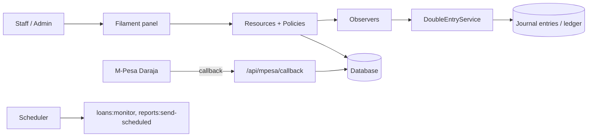

<div align="center">


</div>

Growfunder is a web-based **loan management system** for lenders and cooperatives. It covers borrowers, loan products, repayments, wallets and a full double-entry ledger, with a Filament admin panel and permission-gated modules.

## ✨ Features

- 👤 **Borrowers and loans**: applications, loan types (rate and interest cycle), restructures, roll-overs, agreement and settlement forms (PDF)
- 💸 **Repayments** tracking, with **bulk import** of borrowers, loans and repayments plus an import log
- 📱 **M-Pesa payments** through Safaricom Daraja, with callback, timeout and status-query endpoints
- 👛 **Wallets and transfers** (e.g. loan wallet → expense wallet) with a full transaction history
- 📒 **Double-entry accounting**: chart of accounts, journal entries, ledger, trial balance, statement of financial position, comprehensive income and cash flow
- 🧾 **Expenses, assets, payroll** (employees, salary scales, tax bands, payslips)
- 🗂️ **Document management** for KYC, agreements and other borrower files
- 🤖 **AI credit scoring** service that calls an OpenAI-compatible API (`OPENAI_API_KEY`)
- 📊 **Dashboard widgets** (portfolio overview, outstanding balance, repayment trends, revenue vs expenses) and Excel exports
- 📧 **Scheduled reports**: agent (daily 09:00), system and investor (Mondays) plus a daily loan-monitoring job
- 🔐 **Roles and permissions** with Filament Shield, multi-branch support and an activity log

## 🏗️ Architecture



## 🧰 Tech stack

| Layer | Technology |
| --- | --- |
| Backend | PHP 8.2+, Laravel 10, Jetstream, Sanctum |
| Admin UI | Filament 3, Livewire 3, Tailwind CSS, Vite |
| Access control | Filament Shield (spatie permissions), policies |
| Finance | bavix/laravel-wallet, custom double-entry service |
| Documents / export | dompdf, PhpWord, filament-excel |
| Integrations | M-Pesa Daraja, OpenAI-compatible API, SMTP mail |
| Deployment | Docker (Apache + PHP 8.3), Railway config |

## 🚀 Getting started

```bash
git clone https://github.com/Brian-Dol/grofunder.git
cd grofunder

composer install
npm install && npm run build

cp .env.example .env
php artisan key:generate
# set DB_* and MAIL_* values in .env, then:
php artisan migrate
php artisan db:seed --class=ChartOfAccountsSeeder
php artisan shield:install
php artisan shield:generate --all
php artisan shield:super-admin
php artisan db:seed --class=LinkExistingWalletsSeeder
php artisan serve
```

Run `php artisan schedule:work` for the scheduled jobs. M-Pesa, bulk import, document management and scheduled reports are documented in [`docs/`](docs).

## 📁 Project structure

```text
app/Filament/Resources/   Filament resources (loans, borrowers, wallets, accounting, payroll...)
app/Services/             DoubleEntryService, MpesaService, AICreditScoringService, report services
app/Observers/            Model observers (ledger posting, activity logging)
app/Console/Commands/     loans:monitor, reports:send-scheduled, admin helpers
docs/                     Feature guides
```

## 🗺️ Notes

- Scope: a customised Laravel/Filament loan platform; some docs (bulk import) assume Zambian/Ugandan phone and currency formats.
- Needs hardening before production: the repo contains `.env.railway` (deployment settings, committed) and temporary debug routes in `routes/web.php` (`/test-db`, `/logs`, `/run-seeders`) that should be removed or protected.

## 👤 Author

**Brian Dol**, Senior Full Stack Engineer · [Portfolio](https://portfolio.briandol.workers.dev/) · [LinkedIn](https://linkedin.com/in/brian-dol-31a06115a/)
